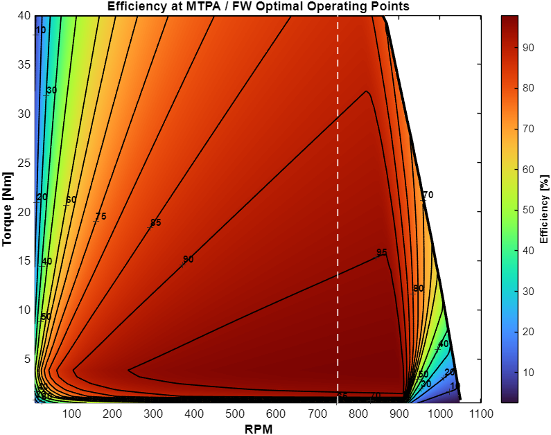
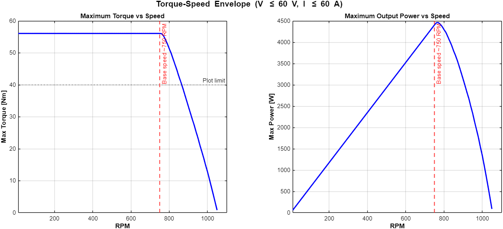
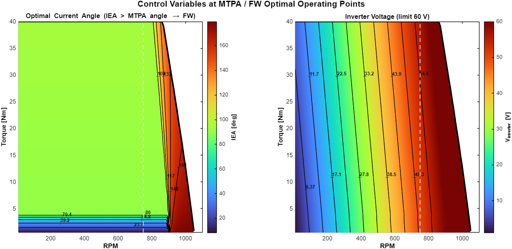
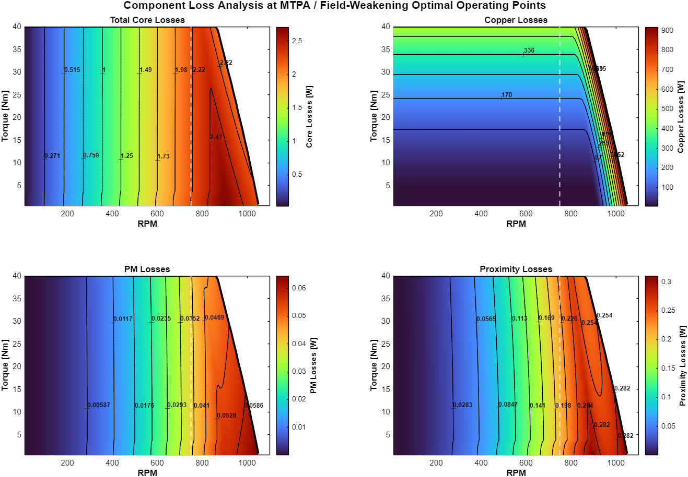
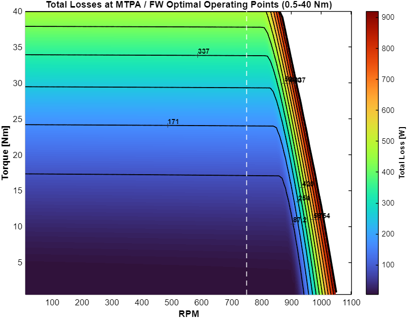

# FEMM SPM Motor Toolkit

MATLAB + [FEMM 4.2](https://www.femm.info) toolkit for the parametric design, finite-element analysis and
**MTPA / field-weakening efficiency mapping** of a surface-mounted permanent-magnet (SPM) synchronous motor.

Developed by **F.G. Kyrgios** (2025–2026) as part of a Diploma Thesis in Electrical Machine Design,
National Technical University of Athens (NTUA).

MATLAB drives FEMM through its MATLAB interface. FEMM computes the magnetic field. MATLAB then post-processes
the stored field data into losses, voltages, optimal control points and efficiency maps.



---

## Contents

1. [Workflow](#workflow)
2. [Requirements](#requirements)
3. [Repository structure](#repository-structure)
4. [Quick start](#quick-start)
5. [Step 1 – Parametric geometry](#step-1--parametric-geometry-geometry)
6. [Step 2 – FEMM sweep](#step-2--femm-sweep-fea_sweep)
7. [Step 3 – MTPA / field-weakening maps](#step-3--mtpa--field-weakening-maps-postprocessing)
8. [Example results (model MP6-1)](#example-results-model-mp6-1)
9. [Development history](#development-history)
10. [Known limitations](#known-limitations)
11. [License and citation](#license-and-citation)

---

## Workflow

```
 geometry/MainMotorAnalysisTool.m          fea_sweep/MotorParallelProcessing.m        postprocessing/MTPAMaps.m
┌──────────────────────────────┐          ┌───────────────────────────────────┐       ┌──────────────────────────────────┐
│ Design parameters (MSV)      │  .FEM    │ For every Js × IEA × rotor angle: │ .mat  │ Losses, dq voltages, currents    │
│ → draws stator, rotor,       │ ───────► │   set 3-phase currents, solve,    │ ────► │ → MTPA + field weakening optimum │
│   magnets, winding in FEMM   │  model   │   store B, A, flux linkage, T     │ data  │ → torque-speed envelope          │
└──────────────────────────────┘          └───────────────────────────────────┘       │ → loss / power / efficiency maps │
                                                                                      └──────────────────────────────────┘
```

| Step | Script | Input | Output |
|------|--------|-------|--------|
| 1 | `geometry/MainMotorAnalysisTool.m` | Design parameters in `MSV_SPM_PrometheusMotor.m` | FEMM model (save it as `.FEM`) |
| 2 | `fea_sweep/MotorParallelProcessing.m` | `.FEM` model | `results/<model>_complete_data.mat` |
| 3 | `postprocessing/MTPAMaps.m` | `<model>_complete_data.mat` | Figures + `MTPA_optimal_losses_0.5-40Nm.mat` |

A ready-made model (`models/MP6-1.FEM`) is included, so you can start directly at step 2.

---

## Requirements

- **FEMM 4.2** (Windows), with its MATLAB interface. The scripts expect it in `C:\femm42\mfiles`;
  if FEMM is installed elsewhere, change the `addpath('C:\femm42\mfiles')` line.
- **MATLAB R2019b or newer**, with the following toolboxes:
  - **Optimization Toolbox** (`fmincon`), used in step 3
  - **Curve Fitting Toolbox** (`fnder`), used in step 3
- **RAM for step 3:** the `_complete_data.mat` file is loaded completely into memory.
  For the MP6-1 grid (14 Js × 15 IEA × 46 rotor positions, ~24k mesh elements) this needs about **6 GB of free RAM**.

---

## Repository structure

```
FEMM-SPM-Motor-Toolkit/
├── geometry/                       Step 1 – parametric FEMM model generation
│   ├── MainMotorAnalysisTool.m       entry point
│   ├── MSV_SPM_PrometheusMotor.m     Machine State Vector: all design parameters
│   ├── Configuration_PrometheusMotor.m  solver settings, group numbers, mesh sizes
│   ├── OpenFEMM.m                    opens FEMM, defines the planar problem
│   ├── MaterialsBcs_PrometheusMotor.m   materials (magnets, M235 / M-19 steel, copper), circuits, BCs
│   ├── DrawStatorGeometry.m          stator, slots, tooth tips, periodic boundaries
│   ├── DrawRotorGeometry.m           rotor yoke, magnets, sliding band
│   ├── CreateWinding.m               winding layout from the winding sequence
│   └── functions/                    geometric helper functions (points, arcs, segments, labels …)
├── fea_sweep/
│   └── MotorParallelProcessing.m   Step 2 – FEMM sweep with auto-save & resume
├── postprocessing/
│   └── MTPAMaps.m                  Step 3 – losses, MTPA + field weakening, maps
├── models/
│   └── MP6-1.FEM                   example FEMM model (the design the example results belong to)
├── docs/figures/                   example output figures
└── results/                        sweep output is written here (ignored by git)
```

---

## Quick start

```matlab
% Step 2: run the FEMM sweep on the example model (select models/MP6-1.FEM when asked)
run('fea_sweep/MotorParallelProcessing.m')

% Step 3: build the maps (select results/MP6-1_complete_data.mat when asked)
run('postprocessing/MTPAMaps.m')
```

The sweep can take many hours: 14 × 15 current points × 46 rotor positions = 9660 FEMM solutions.
It **saves after every (Js, IEA) point**. If it is interrupted, run it again and it continues where it stopped.

---

## Step 1 – Parametric geometry (`geometry/`)

`MainMotorAnalysisTool.m` reads the design from `MSV_SPM_PrometheusMotor.m` and draws the complete FEMM model:

| Group | Parameter (in `Motor.Configuration`) | Meaning |
|-------|------|---------|
| Basic | `Poles`, `Slots`, `Layers`, `Shift`, `Phases` | Machine topology (default 8 poles / 48 slots) |
| | `Periodicity` | 1 = model only one periodic section `t = gcd(Poles, Slots)` with anti-periodic boundaries |
| | `AirGap`, `ActiveLength` | Air gap [mm], FEMM depth [mm] (kept at 1 mm; results are scaled by the real length later) |
| | `Bars`, `NumOfBars`, `Lx`, `Ly`, `radius` | Conductor representation in the slot (0 = none, 1 = max-size bars, 2 = fixed-size bars with fillet) |
| Winding | `Winding.Sequence` | Slot-by-slot phase sequence, e.g. `A|A|b|b|C|C|…` (upper case = +, lower case = −) |
| Stator | `Rso`, `WbiRatio`, `WtRatio`, `beta_t`, `theta_tip`, `h_tp`, `CoilTurns` | Outer radius and yoke/tooth/tip proportions, turns per coil |
| Rotor | `Rri`, `Rro` | Rotor inner / outer radius [mm] |
| Magnet | `Hmag`, `Hmage`, `theta_mag`, `Nodes` | Magnet thickness (centre / edges), pole-arc ratio, number of nodes on the outer magnet contour |

`Configuration_PrometheusMotor.m` defines the **FEMM group numbers**. The later steps rely on them:

| Group | Region |
|-------|--------|
| 101 | Stator iron |
| 103 | Stator winding |
| 201 | Rotor iron |
| 302 | Magnets |
| 901 / 902 | Air / air gap |

After the script finishes, save the model from FEMM (*File → Save As*) as a `.FEM` file.

---

## Step 2 – FEMM sweep (`fea_sweep/`)

`MotorParallelProcessing.m` sweeps

- **Js**: current density [A/mm²]. The peak phase current is `Is = Awire · Js`, with `Awire = 3.86035 mm²`.
- **IEA**: current angle [°]. `Id = Is·cos(IEA)`, `Iq = Is·sin(IEA)`. IEA > 90° means negative Id (field weakening).
- **SR**: rotor position, `0 : dtheta : 360/P` mechanical degrees (one electrical period).

For every point it sets the three phase currents with the inverse Park transform, rotates the rotor through the
sliding band, solves, and stores:

| Stored field | Content |
|--------------|---------|
| `data_store.B{Js,IEA}` | Flux density (complex, Bx + jBy) of every iron / winding element, for every rotor position |
| `data_store.A{Js,IEA}` | Vector potential of every magnet element (used for magnet eddy-current losses) |
| `data_store.fluxA/B/C{Js,IEA}` | Phase flux linkages vs. rotor position |
| `data_store.torque{Js,IEA}` | Torque vs. rotor position (weighted stress tensor on the rotor blocks) |
| `data_store.mesh` | Element centroids, areas and group numbers |

> **Model-specific settings:** the torque is integrated over the blocks selected by `mo_selectblock(45,18)` and
> `mo_selectblock(35,14)`. These are points inside the rotor of the included model. If you change the geometry,
> update them to points inside your rotor blocks. `Awire` must be the same in the sweep and in `MTPAMaps.m`.

---

## Step 3 – MTPA / field-weakening maps (`postprocessing/`)

`MTPAMaps.m` does everything else, in five stages.

### 1. Losses and equivalent circuit, for each (Js, IEA, speed)

- **Voltages:** the phase flux linkages are differentiated with respect to rotor angle (spline) and transformed to
  dq with the amplitude-invariant Park transform. This gives the dq back-EMF, `V = ω · dλ/dθ`, which includes armature
  reaction, so field weakening from negative Id appears automatically.
- **Core losses** (hysteresis + eddy, stator and rotor): these are computed from the FFT of every element's flux
  density, weighted by element volume. Hysteresis is `ch · f · B²`, eddy is `ce · f² · B²`, and both are divided by
  the stacking factor `cs`.
- **Proximity losses** in the winding: `cePhase = π²/8 · d²_wire · k_fill · σ_Cu(T)`.
- **Magnet eddy-current losses:** these come from the harmonics of the magnet vector potential, after removing the
  average current density in each magnet (net magnet current = 0).
- **Copper losses:** `3 · R_phase · I_rms²`, with the resistance evaluated at the operating temperature.
- **Equivalent circuit:** core losses are represented by a parallel resistance `Rm`, and copper plus proximity losses
  by a series resistance `Rs`. This gives the terminal quantities `Vd, Vq, Id, Iq` in **peak values**, from which the
  inverter voltage `|Vdq|` and inverter current `|Idq|` follow.

### 2. Interpolation

Each quantity is interpolated over (Js, IEA) with `griddedInterpolant` (`makima`), separately for every speed.

### 3. Maximum torque envelope

For every speed the script finds the maximum torque that satisfies

```
|Vdq| ≤ V_limit   (inverter peak phase voltage, 60 V)
|Idq| ≤ I_limit   (inverter peak phase current, 60 A)
```

using a dense grid search followed by `fmincon`. The **base speed** is the first speed where the voltage limit
becomes active at maximum torque.

### 4. MTPA + field-weakening optimisation

For every (speed, torque) point:

```
minimise   Js                       (minimum current)
subject to T(Js, IEA)        = T_target
           |Vdq|(Js, IEA, n) ≤ V_limit
           |Idq|(Js, IEA, n) ≤ I_limit
```

Below base speed the voltage constraint is inactive and the result is plain **MTPA**. Above base speed it becomes
active, and the optimiser increases IEA beyond 90° (negative Id), which is **field weakening**. Points above the
torque envelope cannot be reached and are left empty.

### 5. Figures

| Figure | Content |
|--------|---------|
| 1 | Core, copper, PM and proximity losses at the optimal points |
| 2 | Total losses |
| 3 | Output and input power |
| 4 | Efficiency |
| 5 | Maximum torque and maximum power vs. speed |
| 6 | Optimal current angle and inverter voltage |

The torque envelope (black line) and base speed (dashed line) are drawn on every map.

### Main settings (top of `MTPAMaps.m`)

| Variable | Default | Meaning |
|----------|---------|---------|
| `P, Q, L` | 4, 48, 48 | Pole pairs, slots, active length [mm] (FEMM results ×  `t · L`) |
| `Turns, FillFactor, Dwire, Awire` | 13, 0.778, 2.257 mm, 3.86 mm² | Winding data |
| `TemperatureRise` | 150 K | Copper temperature rise for resistance / proximity losses |
| `ch, ce, cs` | 108.7, 0.53, 0.95 | Core loss coefficients and stacking factor |
| `omag` | 0.556 MS/m | Magnet conductivity |
| `RPM_step, RPM_max` | 10, 1500 | Speed range. **It must extend past the base speed** to show field weakening |
| `V_limit, I_limit` | 60 V, 60 A | Inverter peak phase voltage / current |
| `T_min_plot, T_max_plot` | 0.5, 40 Nm | Torque range of the maps |

---

## Example results (model MP6-1)

MP6-1 results with the default settings (V ≤ 60 V peak, I ≤ 60 A peak):

| Quantity | Value |
|----------|-------|
| PM flux linkage ψm (from FEMM) | 0.157 Wb |
| d-axis inductance Ld (from FEMM) | ≈ 0.39 mH |
| Maximum torque (limited by I_limit) | 56.1 Nm |
| Base speed | ≈ 750 RPM |
| Maximum power | ≈ 4.4 kW at base speed |
| Maximum speed | ≈ 1050 RPM |
| Peak efficiency | ≈ 98 % |

**Plausibility check:** the characteristic current ψm/Ld ≈ 400 A is much larger than the 60 A inverter limit.
Field weakening can therefore reduce the d-axis flux by only about 15%
(ψd = ψm − Ld·60 A ≈ 0.133 Wb), so the torque falls quickly above base speed.
A hand calculation gives a no-load maximum speed of 60 V / (P · ψd) ≈ 1080 RPM, close to the ≈ 1050 RPM from the
optimisation (which also includes the resistive voltage drop). This short field-weakening range is expected for an
SPM machine with low inductance.

| | |
|---|---|
|  |  |
|  |  |

---

## Development history

| Date | Change |
|------|--------|
| 03/2025 | Parametric SPM geometry tool: MSV, configuration, materials, stator / rotor drawing |
| 04–11/2025 | Winding generator and geometric helper functions (conductor bars, block labels, perpendicular segments) |
| 09/2025 | FEMM sweep over current density, current angle and rotor position (`ProcessingFEMM`) |
| 02/2026 | Resumable sweep (`MotorParallelProcessing.m`); loss post-processing and MTPA maps (`MTPAMaps.m`) |
| 09/2026 | **Field-weakening revision of `MTPAMaps.m`**, see below |

### 09/2026 – Field-weakening revision

The earlier MTPA maps did not show the torque drop at high speed. There were three causes:

1. **Speed range:** it ended at 400 RPM, below the base speed. The voltage limit was never reached, so field
   weakening never happened. The range is now `RPM_step : RPM_step : RPM_max` (default up to 1500 RPM).
2. **Gap filling:** operating points that the optimiser could not reach were filled with their nearest
   neighbour's values. This hid the torque envelope. Unreachable points are now left empty, and the envelope is
   computed explicitly and drawn on every map.
3. **Limits as masks:** the inverter limits were applied by deleting grid points, which gave a jagged boundary.
   They are now `fmincon` inequality constraints on smooth voltage and current surfaces, so the optimiser can move
   along the voltage limit into negative Id.

Further changes:

- **Peak / RMS mix-up fixed:** the equivalent-circuit currents `Idin, Iqin` used `IdAmp/√2` (RMS) together with a
  peak back-EMF. Everything is now in peak values, consistent with the peak inverter limits.
- **Empirical correction factors removed** from all loss components (core ×4.68/1.18, proximity ×25/2,
  PM ×6.2/1.1, copper ×1.96). The losses now follow the physical formulas and material constants only.
- **Memory:** the dense 3-D interpolation arrays (several GB) were replaced by interpolants on the FEA grid.
  Speed-independent quantities are computed once, outside the speed loop.
- **New figures:** the torque-speed and power-speed envelope, and maps of the optimal current angle and inverter
  voltage.

---

## Known limitations

- **Low-torque region:** the first Js value (0.001 A/mm², effectively no load) is excluded. Below about 4 Nm the
  smallest remaining current already gives more torque than requested, so the optimiser reduces torque by rotating
  the current angle below 90°. The maps are less meaningful in this region.
- **End-winding length:** `l_turn = 1.2·(2L + 2·Wts)·10⁻³` in `MTPAMaps.m` adds `L` in mm to `Wts` in m, so the
  tooth-width term is effectively ignored.
- **FFT sampling:** the rotor-position vector `0:dtheta:360/P` includes both ends of the period, so one sample is
  repeated in the FFT. The effect on the harmonic losses is small.
- **Scope:** the torque block coordinates and the group numbers are tied to the included geometry (see step 2).
- **Loss models:** these are 2-D analytical/FEA models. End effects, 3-D magnet segmentation and mechanical losses
  are not included.

---

## License and citation

Released under the [MIT License](LICENSE). You may use, modify and distribute it freely.
Please keep the author notices.

If you use this toolkit in academic work, please cite:

> F.G. Kyrgios, *Parametric design, FEM analysis and MTPA / field-weakening efficiency mapping of a
> surface-mounted PM synchronous motor*, Diploma Thesis, Electrical Machine Design, National Technical University
> of Athens (NTUA), 2025–2026.

The loss post-processing follows the continuum approach used in David Meeker's FEMM loss-calculation examples
([femm.info](https://www.femm.info)). FEMM is © David Meeker and is distributed separately under its own license.
